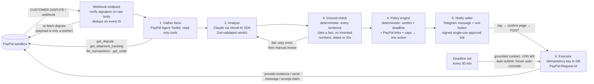

# Rebuttal

**An AI agent that answers every PayPal dispute before the deadline.** It contests with real evidence when the seller is right, recommends a refund when the seller is wrong, and the seller resolves each case with one tap from a chat message.

Live demo: **https://rebuttal-eta.vercel.app** · Built for the PayPal AI Hackathon · MIT licensed

---

## The problem

When a buyer opens a PayPal dispute, the seller has a short window to respond with evidence. Small sellers miss it, or reply badly, and lose by default. PayPal's own Agent Toolkit exposes three dispute tools: `list_disputes`, `get_dispute`, `accept_dispute_claim`. So an AI agent connected to a seller's account can read a dispute and concede it, but it cannot contest it.

Rebuttal is the missing half. It covers one dispute reason end to end: **item not received** (`MERCHANDISE_OR_SERVICE_NOT_RECEIVED`). Every other reason gets a plain "needs manual review" message instead of a guess.

## How it works



Every step is written to a per-case timeline (`/cases/[id]`) with the PayPal endpoint and debug ID behind a "Technical details" toggle, and to an append-only audit log.

## How PayPal is used

| What | How |
|---|---|
| **PayPal Agent Toolkit** (`@paypal/agent-toolkit/ai-sdk`) | The agent's investigation tools, configured **read-only**: `get_dispute`, `list_disputes`, `get_order`, `get_shipment_tracking`, `list_transactions`. Every result becomes a numbered fact the model must cite. |
| **Disputes API** | `GET /v1/customer/disputes/{id}` is the source of truth for status, deadline, requested evidence and allowed actions (`links`). Writes: `provide-evidence` (multipart, `PROOF_OF_FULFILLMENT` + tracking), `send-message`, `accept-claim`, each with a `PayPal-Request-Id` idempotency key. |
| **Webhooks** | `CUSTOMER.DISPUTE.CREATED / UPDATED / RESOLVED`, verified with `POST /v1/notifications/verify-webhook-signature` against the raw body. |
| **Add Tracking API** | `POST /v1/shipping/trackers-batch` puts the seller's tracking on the PayPal transaction. When a seller replies to the bot with a tracking number, Rebuttal adds it to PayPal, then re-reads it, so evidence always traces to a PayPal record. |
| **Orders v2 + Vault** | The demo merchant's sandbox buyer approved one vaulted payment. Demo payments are then charged server-side with no browser. |

Everything runs against the **PayPal sandbox**. The findings from the initial spike, including what the sandbox does and does not allow, are in [`docs/SANDBOX_NOTES.md`](docs/SANDBOX_NOTES.md).

## How AI is used

- **Claude** (Anthropic), called through the **Vercel AI SDK**: direct with an Anthropic key, or through OpenRouter as a fallback.
- The model receives the facts and the buyer's message. The message sits in a randomly delimited block marked as untrusted data.
- It returns a **Zod-validated** object: `verdict` (`CONTEST` / `CONCEDE` / `NEEDS_SELLER_INPUT` / `MANUAL_REVIEW`), `confidence`, a plain-language `reasoning_summary`, an `evidence_plan`, a `rebuttal` where every sentence carries the fact IDs that support it, and `missing`.
- The model may call the read-only toolkit tools during analysis. Each result is recorded as a new fact first, so it can be cited.
- The model **recommends**; it never acts. Deterministic code decides what is sent to PayPal.

## Safety model (short version; full version in [`docs/SAFETY.md`](docs/SAFETY.md))

1. **The model has no money-moving tools.** The toolkit is configured read-only and fails closed if it ever exposes more. Only the policy engine plus executor can write.
2. **Buyer text is untrusted.** It's delimited with a random tag and the model is told it is data. The architecture stays safe even if the model is fully fooled. There's a test for exactly that: a mocked, fully compromised model produces zero PayPal writes.
3. **Conceding requires a human.** `accept-claim` runs only after seller approval. Above a configurable cap, the seller must type the amount.
4. **Approval links** are HMAC-signed, single-use, bound to one case, one action and one draft, and expire in 24 hours. GET only renders a confirmation page; the action runs on POST, so chat link previews can't trigger it.
5. **No fabricated evidence.** A deterministic ground-check rejects any sentence with no citation, an unknown fact ID, or a tracking number, date, amount or ID not present in the cited facts.
6. **Deadline net.** Every 30 minutes it auto-submits grounded contests with under 24 hours left. It never auto-concedes; refund recommendations get escalating reminders instead.
7. **Idempotency in the database.** A unique request ID per case, action and draft means double taps, repeated webhooks and overlapping cron runs produce exactly one PayPal call.
8. **Append-only audit log.** A database trigger rejects UPDATE and DELETE.
9. **Secrets** live in server environment variables only; see `.env.example`.
10. **Demo endpoints** are rate-limited per IP and globally, and only touch the demo merchant's sandbox data.

## For judges: two-minute test

1. Open **https://rebuttal-eta.vercel.app/demo**.
2. Pick a scenario:
   - **A**: the seller shipped and tracking is on file. The agent should contest.
   - **B**: nothing was shipped. The agent should recommend a refund.
   - **C**: the buyer's message tells the AI to refund. Watch it get contained.
3. You claim one **real** dispute filed in the PayPal sandbox. The case page shows the timeline filling in live: facts gathered, Claude's verdict, the ground-check, the policy decision.
4. Under **What the seller sees** is the same message and button the seller gets in Telegram. Tap it, confirm, and Rebuttal sends the response to PayPal. The timeline shows the PayPal endpoint, the debug ID and the resulting status.
5. Open any step's **Technical details** to see the raw facts, the model output and PayPal debug IDs.

You don't need a PayPal account. **Why a pool of pre-filed disputes?** The PayPal sandbox does not let an app open disputes by API; a sandbox buyer has to file them in the Resolution Center. So the demo keeps real disputes on hold until a visitor claims one. Everything after the claim is live. If a scenario's pool is empty, the page says so.

## Run it yourself

Requirements: Node 22, Postgres 16 (or Docker), a PayPal developer account, and an Anthropic or OpenRouter key.

```bash
git clone https://github.com/emediong-etuk/rebuttal && cd rebuttal
npm ci
```

```bash
docker compose up -d
```

```bash
cp .env.example .env.local
```

Fill in `.env.local`:
- PayPal sandbox client ID and secret
- `ANTHROPIC_API_KEY` or `OPENROUTER_API_KEY`
- `APPROVAL_SECRET`: any 32+ character random string

```bash
export $(grep -v '^#' .env.local | xargs) && npm run db:migrate
```

```bash
npm run dev
```

```bash
npm test
```

Tests run against the `rebuttal_test` database that `docker compose` creates.

To receive webhooks, deploy (below) or tunnel to `localhost:3000`, then:

```bash
APP_URL=https://your-public-url npm run seed
```

This registers the PayPal webhook and pulls open disputes into the demo pool. Put the printed webhook ID into `PAYPAL_WEBHOOK_ID`.

### Deploy

- **Vercel** (used for the live demo):
  1. Import the repo.
  2. Add a Neon Postgres database from the Storage tab.
  3. Set the variables from `.env.example`. `vercel.json` runs migrations at build time.
  4. Add `APP_URL` and `CRON_SECRET` as GitHub Actions secrets. `.github/workflows/deadline-net.yml` then runs the deadline net every 30 minutes.
- **Render**: `render.yaml` is a Blueprint for a web service, Postgres and a cron job. In Render choose **New → Blueprint**, pick this repo and fill in the secrets.

### Telegram (seller notifications)

1. In Telegram, message **@BotFather** → `/newbot` → copy the token into `TELEGRAM_BOT_TOKEN` and redeploy.
2. Send `/start` to your new bot.
3. Run this once:

   ```bash
   curl -X POST "$APP_URL/api/telegram/setup" -H "Authorization: Bearer $CRON_SECRET"
   ```

   It saves your chat ID and registers the bot's webhook, so the token never leaves the server.

After that, every case sends you one message with one button. If Rebuttal needs a tracking number, reply with it in plain text (e.g. `USPS 9400111202555842761025`). Without Telegram, the same message and button appear on the case page under "What the seller sees".

## Project layout

```
src/agent/      toolkit.ts (read-only toolkit) · facts.ts · analyze.ts (Claude) · groundCheck.ts · policy.ts
                pipeline.ts · executor.ts (only PayPal writer) · intake.ts (webhooks, demo pool) · deadline.ts
src/paypal/     typed REST client + dispute schema
src/lib/        approvals (signed links) · webhook intake · audit/timeline · rate limit
src/app/        landing, /demo, /cases, /cases/[id], /approve/[token], API routes
tests/          policy, ground-check, injection, webhooks, approvals, idempotency, toolkit
scripts/        migrate, seed, cron-deadline, sandbox-integration; spike/ holds the Phase 0 sandbox probes
docs/           SANDBOX_NOTES, SAFETY, ARCHITECTURE, DEVPOST, VIDEO_PITCH, VIDEO_TECHNICAL
```

No PayPal logos or trademarks are used in the UI; PayPal is named in text only. Not affiliated with PayPal.
