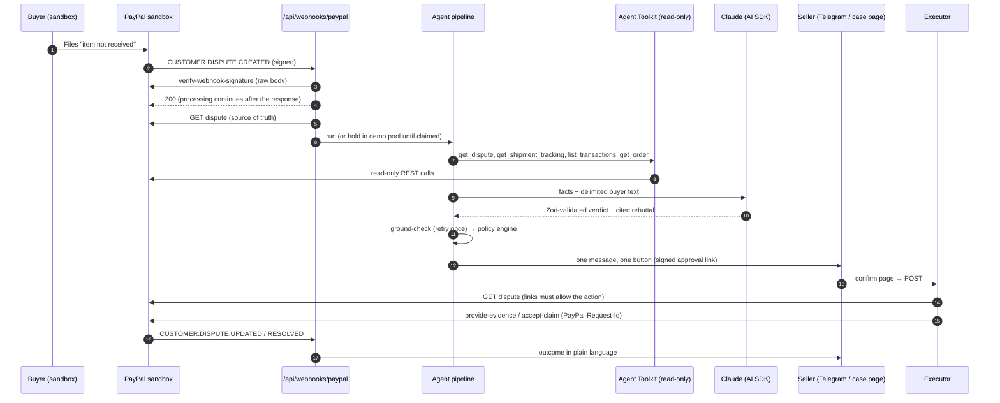

# Architecture

## Components

| Component | File | Notes |
|---|---|---|
| Typed PayPal REST client | `src/paypal/client.ts` | Token cache, `PayPal-Request-Id` on writes, debug ID on every result, `PayPalError` carries the redacted request shape. |
| Read-only toolkit | `src/agent/toolkit.ts` | `@paypal/agent-toolkit/ai-sdk` (bundles `ai@4`/`zod@3`). Tools are re-wrapped for `ai@7` with `zod-to-json-schema`. |
| Fact store | `src/agent/facts.ts` | Sequential IDs F1…Fn, source endpoint, timestamp. The buyer's words are a separate `buyer_message` fact marked untrusted. |
| Analysis | `src/agent/analyze.ts` | `generateText` + `Output.object(analysisSchema)`. During analysis the model may call read-only tools; each result becomes a new fact first. Anthropic direct or OpenRouter. |
| Ground-check | `src/agent/groundCheck.ts` | Pure function. |
| Policy engine | `src/agent/policy.ts` | Pure functions `decide()` and `authorizeExecution()`. |
| Pipeline | `src/agent/pipeline.ts` | Orchestrates steps 1–5 and writes the timeline and audit log. |
| Executor | `src/agent/executor.ts` | The only PayPal writer. Re-fetches the dispute, re-decides, authorizes, claims the idempotency key, calls PayPal. |
| Intake | `src/agent/intake.ts` | Webhook processing, demo pool (classify, hold, claim with `FOR UPDATE SKIP LOCKED`), resolution messages. |
| Deadline net | `src/agent/deadline.ts` | Run by GitHub Actions (Vercel) or a Render cron job every 30 minutes. |
| Data | `src/db/schema.ts` | Postgres via Drizzle: `cases`, `facts`, `timeline_events`, `audit_log` (append-only), `webhook_events`, `actions`, `approval_tokens`, `rate_limits`, `settings`. |

## Case states

`NEW → ANALYSING → AWAITING_SELLER | NEEDS_INPUT | MANUAL_REVIEW → SUBMITTING → RESPONDED | CONCEDED → RESOLVED`
(`FAILED` on a PayPal or read error, with the debug ID on the timeline). PayPal's own `status` is stored separately, and only PayPal's view decides what is allowed.

## Demo pool

The sandbox cannot create disputes by API, so new disputes are held in a pool (`settings.hold_new_disputes_for_demo`). When a visitor claims one on `/demo`, the full live pipeline runs on it. Payments for new pool disputes are created server-side by charging the sandbox buyer's vaulted wallet (`npm run seed -- --payments A,B,C`). The buyer then files the dispute in the sandbox Resolution Center.
